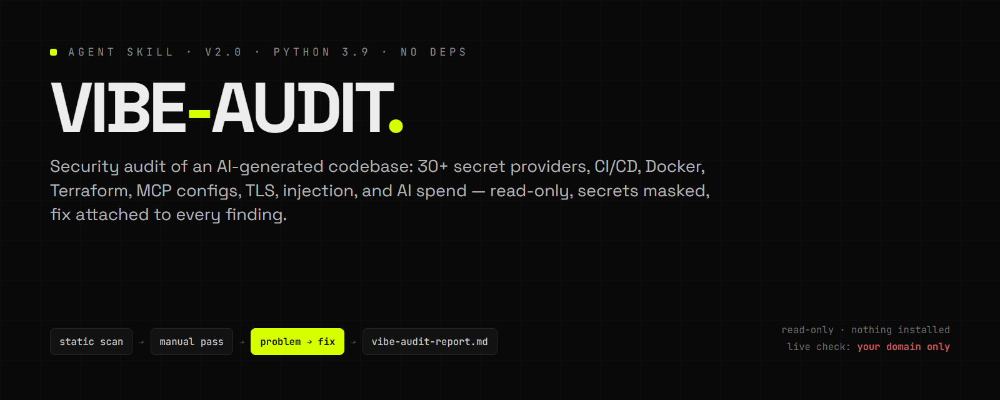
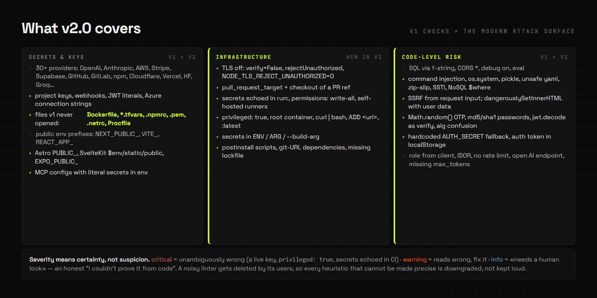
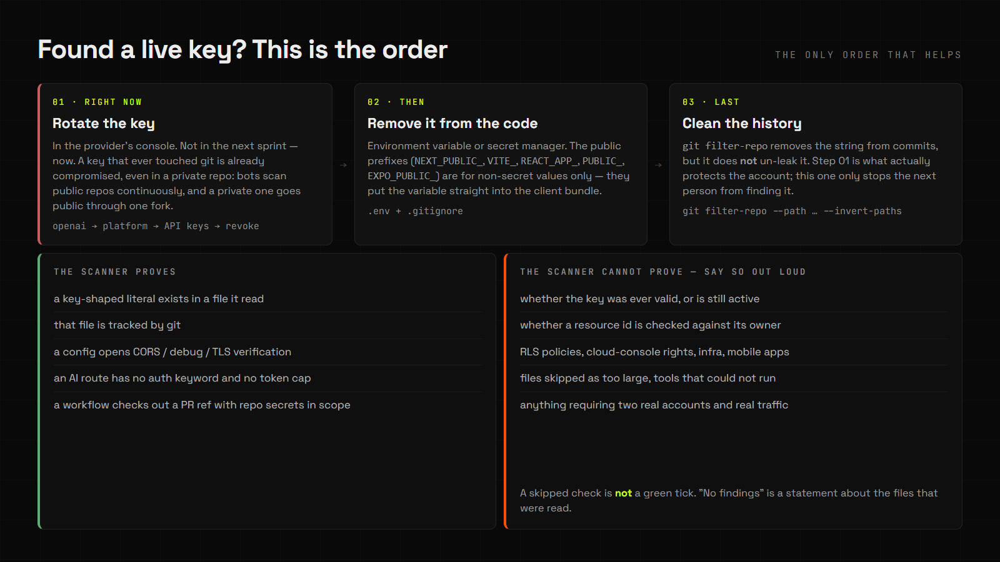

<div align="center">



**Проверь свой вайбкод до того, как это сделают за тебя.**

`статический сканер → ручной проход → проблема → фикс` → `vibe-audit-report.md`

[](LICENSE)


</div>

---

Аудит безопасности проекта, который писал ИИ. Находит типовые дыры вайбкодинга и
выдаёт отчёт **«проблема → как чинить»** с одной главной цифрой: сколько находок и
сколько из них критичных.

Работает в Claude Code, Codex, Cursor, MiniMax Code, OpenCode, Cowork и любом
хосте, который читает `SKILL.md`. Ничего не меняет в проекте, ничего не ставит,
секреты в отчёте маскирует.

## Что проверяет

| Категория | Что ловит |
|---|---|
| 🔑 **Секреты в коде** | 30+ провайдеров: OpenAI (включая `sk-proj-`), Anthropic, AWS, Stripe, Supabase, GitHub/GitLab, npm, PyPI, SendGrid, Twilio, Cloudflare, Vercel, HuggingFace, Groq, OpenRouter, Slack/Discord-вебхуки, PEM-ключи, JWT |
| 📄 **Инфраструктурные файлы** | `.env`, `.npmrc`, `.netrc`, `.pypirc`, `Dockerfile` (`ARG`/`ENV`), `*.tfvars`, `*.pem` — в v1 они просто не открывались |
| 📢 **Публичные env-префиксы** | `NEXT_PUBLIC_`, `VITE_`, `REACT_APP_`, Astro `PUBLIC_`, SvelteKit `$env/static/public`, `EXPO_PUBLIC_` с секретом внутри |
| 🔒 **Отключённый TLS** | `verify=False`, `rejectUnauthorized: false`, `NODE_TLS_REJECT_UNAUTHORIZED=0` — тихая дыра, которую не видно в тестах |
| ⚙️ **Классика** | CORS `*`, `debug=True`, `eval()`, SQL через f-строки, JWT `alg:none`, `ignoreExpiration` |
| 💉 **Инъекции** | Командная (`exec` с подстановкой, `os.system`), `pickle`, небезопасный `yaml.load`, zip-slip, Jinja `render_template_string`, Mongo `$where`, `dangerouslySetInnerHTML`, SSRF из пользовательского ввода |
| 🔑 **Крипто-грабли** | `Math.random()` в OTP/токенах, md5/sha1 для паролей, `jwt.decode` вместо `verify`, HS/RS-путаница, захардкоженный `AUTH_SECRET ?? "dev-secret"`, токен в `localStorage` |
| 🧱 **CI/CD** | `pull_request_target` + checkout чужой ветки (крадут секреты), `echo ${{ secrets.* }}`, `permissions: write-all`, self-hosted раннеры на публичном репо, неприбитые `uses:` |
| 🐳 **Контейнеры и Terraform** | `privileged: true`, `network_mode: host`, root-контейнер, `curl \| bash`, `ADD <url>`, `:latest`, `chmod 777`, порты БД наружу, секрет в `.tfvars` |
| 🧠 **AI-эндпоинты** | Открытый LLM-роут без авторизации, вызов без `max_tokens` / `max_completion_tokens` / `max_output_tokens` — «cost bomb» |
| 🧩 **MCP и агенты** | Буквальный секрет в `.mcp.json`, `mcp_settings.json`, `cline_mcp_settings.json` |
| 📦 **Supply chain** | `postinstall`, `curl \| sh` в npm-скриптах, зависимости с git-URL, отсутствие lockfile |
| 🚦 **Прочее** | Отсутствие rate limit на auth-роутах, роль из тела запроса, IDOR-подозрения, открытые Firebase-правила, дефолтные пароли БД, уязвимые npm-зависимости |
| 🌐 **Live-проверка твоего домена** | Security-заголовки, HSTS, куки (`Secure`/`HttpOnly`/`SameSite`), раскрытие стека, торчащие наружу `.env` / `.git` / дампы / actuator / Swagger / `security.txt` |
| ✅ **Чек-лист перед деплоем** | Spending limits, 2FA, RLS, бэкапы, права сервис-аккаунтов — то, что сканер увидеть не может |



## Установка

Скилл — это папка со `SKILL.md`. Клонируйте её туда, где ваш агент ищет скиллы:

```bash
# глобально (для всех проектов)
git clone git@github.com:Samiixo/vibecode-audit.git ~/.claude/skills/vibe-audit

# или только для одного проекта
git clone git@github.com:Samiixo/vibecode-audit.git <проект>/.claude/skills/vibe-audit
```

Обновление: `cd <путь-к-скиллу> && git pull`.

<details>
<summary>Пути к скиллам в разных хостах</summary>

| Хост | Путь |
|---|---|
| Claude Code | `~/.claude/skills/vibe-audit/SKILL.md` |
| MiniMax Code | `~/.minimax/skills/vibe-audit/SKILL.md` |
| OpenAI Codex | `~/.codex/skills/vibe-audit/SKILL.md` |
| Cursor | `~/.cursor/skills/vibe-audit/SKILL.md` |
| Любой хост с `AGENTS.md` | вставьте ядро в `AGENTS.md` и сошлитесь на `references/` |

</details>

**Требования:** Python 3.9+. Внешних пакетов нет.

> **Windows:** `python3` часто указывает на заглушку Microsoft Store, которая молча
> ничего не делает — проверьте `python --version`. В v1 из-за похожих мелочей
> (`--userconfig /dev/null`, `npm` вместо `npm.cmd`) аудит зависимостей на Windows
> не запускался вообще; в v2.0 это исправлено и покрыто тестом.

## Запуск

Скажите агенту:

> Проверь безопасность моего проекта по vibe-audit

Или руками, без агента вовсе — это просто Python-скрипты без зависимостей:

```bash
python scripts/audit.py /путь/к/проекту
python scripts/audit.py . --json > audit.json          # для CI и разбора агентом
python scripts/livecheck.py https://твой-сайт.com     # только свой домен
python tests/run_selftest.py                          # смоук самого скилла
```

На выходе:

```
🩺 vibe-audit: 16 находок (🔴 13 / 🟡 3 / 🔵 0)
Отчёт: vibe-audit-report.md
```

Полный пример отчёта — [`examples/sample-report.md`](examples/sample-report.md).
Секреты в нём показаны как `sk-li…uv` — целиком не печатаются никогда.

**Коды выхода:** `0` — чисто или только info · `1` — есть warning · `2` — есть
critical **или** ошибка запуска. В CI это разделение важно: сломанный запуск не
должен читаться как предупреждение о безопасности.

```bash
# pre-merge гейт
python scripts/audit.py . --json > audit.json || [ $? -eq 1 ] || exit 1
```

## Проверка задеплоенного сайта

Только против **твоего** домена: скрипт требует подтверждения владения и не
обходит это за тебя.

```bash
python scripts/livecheck.py https://твой-сайт.com
python scripts/livecheck.py https://твой-сайт.com --json          # для CI
python scripts/livecheck.py https://твой-сайт.com --timeout 5     # таймаут
python scripts/livecheck.py https://твой-сайт.com --paths .env,backup.sql
```

Это обычные GET-запросы, как у securityheaders.com: заголовки, куки, проба
фиксированного списка путей. Не сканирование уязвимостей и не атака. Чужие домены
инструмент не проверяет — и не должен.

## Нашёл живой ключ — порядок действий



1. **Перевыпустить ключ прямо сейчас.** Ключ, попавший в git, скомпрометирован,
   даже в приватном репо.
2. Убрать из кода в переменную окружения; публичные префиксы — только для
   несекретных значений.
3. Почистить историю `git filter-repo` — **после** шага 1, и он её не отменяет.

## Честные границы

Это линтер типовых ошибок, **а не пентест**. Он не проверяет глубоко логику
авторизации, права в облачных консолях, RLS-политики Supabase изнутри, инфраструктуру
и мобильные приложения. **Ноль находок ≠ безопасное приложение** — это утверждение
о прочитанных файлах, и всё.

Пропущенный файл, недоступный инструмент, недоступный `npm audit` — всё это
пишется в отчёт явно. Пропущенная проверка — не зелёная галочка. Для продакшена с
деньгами и персональными данными нужен живой специалист.

Подробности о том, что именно доказывает и чего не доказывает сканер, — в
[`references/modern-stack.md`](references/modern-stack.md).

## v2.0: что изменилось

Коротко — полный список в [CHANGELOG.md](CHANGELOG.md), авторство и границы
переделки — в [NOTICE.md](NOTICE.md).

- **Сканер переписан в модули** и расширен с 9 провайдеров ключей до 30+, добавлены
  CI/CD, контейнеры, Terraform, MCP, TLS, инъекции за пределами SQL и SSRF.
- **14 дефектов исправлено, каждый воспроизведён перед правкой.** Среди них:
  падение `UnicodeEncodeError` на русской Windows-консоли, неработающий аудит
  зависимостей на Windows, `Dockerfile`/`.npmrc`/`.tfvars`, которые вообще не
  читались, молчаливый пропуск больших файлов, квадратичное сканирование
  (6.4 с → 0.9 с на минифицированном файле 900 КБ) и сканер, ругавшийся на свои
  же шаблоны регулярных выражений.
- **`--json` у обоих скриптов** — можно использовать как CI-гейт и как вход для агента.
- **Тесты: 28 проверок, 6 секунд, без сети и npm** — сломанная фикстура, чистая
  фикстура, враждебные входные данные и локальный HTTP-сервер для `livecheck`.
  Секреты в фикстурах генерируются в рантайме: в репозитории лежат только
  плейсхолдеры, потому что GitHub push protection блокирует коммиты со
  стрингами, похожими на живые ключи.

## Траблшутинг

| Симптом | Что делать |
|---|---|
| `python3` не работает на Windows | Используй `python` — `python3` там часто заглушка Store |
| В отчёте «Пропущено файлов: N» | Эти файлы слишком большие или нечитаемые; посмотри список, они в отчёте |
| `npm audit не запустился` | Нет npm или сети. Это info-находка, а не ошибка; запусти `npm audit` локально |
| Ложное срабатывание на строке из примера | Переименуй файл в `*.example` / `*.sample`, сканер их пропускает |
| `Проверка X упала` | Внутренняя ошибка одной проверки — прогон продолжается, отчёт продолжает писаться; детали в отчёте |
| Хочу добавить свой паттерн ключа | Добавь его в `SECRET_PATTERNS` в `scripts/checks_secrets.py` и прогонни `python tests\run_selftest.py` |

## Поддержка

Вопросы и ложные срабатывания — в Issues, с фрагментом строки **без реальных
ключей**. PR с новыми проверками — самый ценный вклад: добавь кейс в
`tests/fixtures/broken` и ожидаемую находку в `run_selftest.py`.

## Лицензия и авторство

MIT — [LICENSE](LICENSE). Оригинальный скилл `vibe-audit` написан **ika.explains**
(MIT) и хостится в [haraldalder-vibemogger/vibe-audit](https://github.com/haraldalder-vibemogger/vibe-audit);
копирайт оригинала сохранён без изменений, все правки перечислены в
[NOTICE.md](NOTICE.md). Если делаете форк — не вырезайте атрибуцию, этого требует
лицензия.

---

## English summary

`vibe-audit` is a security-audit skill for AI coding agents. A read-only static
scanner (Python 3.9, zero dependencies) checks a codebase for hardcoded secrets
across 30+ providers, secrets hiding in infrastructure files (`Dockerfile`,
`.npmrc`, `*.tfvars`, PEM), CI/CD misconfiguration, container and Terraform
problems, disabled TLS verification, injection beyond SQL, SSRF, weak auth and
crypto, and open AI endpoints without a token cap. `livecheck.py` performs plain
GET requests against **a domain you confirmed you own** to check security
headers, cookie flags and accidentally exposed files.

Every finding is `problem → fix`, secrets are always masked, nothing is written
into your project, and the tool fixes nothing without your explicit go-ahead. It
also reports what it could **not** check — a skipped file is never a green tick.

Exit codes: `0` clean · `1` warnings · `2` blockers (or a tool error). Both scripts
support `--json` for CI and for agents. A self-test (`tests/run_selftest.py`)
covers a deliberately broken fixture, a clean fixture, hostile inputs and a
localhost server: 28 checks, ~6 s, no network, no npm.

Upstream: `vibe-audit` by **ika.explains** (MIT), hosted at
github.com/haraldalder-vibemogger/vibe-audit — copyright preserved, changes
documented in [NOTICE.md](NOTICE.md).